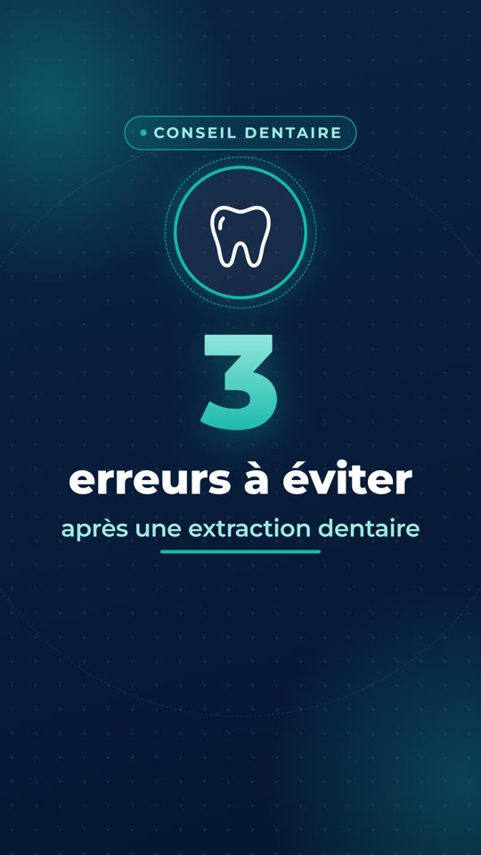
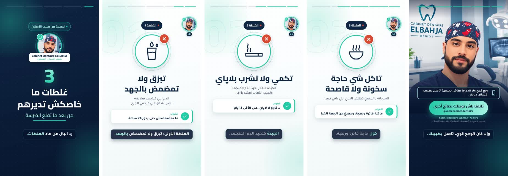

# Dental Motion Graphics 🦷

A [Remotion](https://www.remotion.dev) template project for **educational dental videos in Moroccan Darija**, vertical format, with an AI voice-over, ready to post on Instagram Reels and TikTok.

The first video is **« 3 غلطات ما خاصكش تديرهم من بعد ما تقلع الضرسة »** (3 mistakes to avoid after a tooth extraction), about 30 seconds long.

| Preview | Cover |
| :---: | :---: |
|  |  |



## Specs

| | |
| --- | --- |
| Format | 1080 × 1920 (9:16), 30 FPS |
| Language | Moroccan Darija in Arabic script, right-to-left layout |
| Voice-over | ElevenLabs AI voice, one clip per narration line, subtitles synced to the voice |
| Duration | ~30 s, computed from the content. A scene gets longer automatically if its voice needs more time |
| Output | MP4 H.264 + AAC audio, `yuv420p`, BT.709, CRF 18 |
| Design | White, dark blue (`#0B2545`) and turquoise (`#14B8A6`); Cairo + Tajawal Arabic fonts bundled locally |
| Presenter | Your photo + name in the intro and in the final call to action |
| Music | Background track (ElevenLabs Music) that ducks automatically under the voice, with fades. Settings in `music`. The audio is normalized to -14 LUFS after rendering (`scripts/normalize-audio.mjs`) |
| Sound effects | Whoosh on transitions, pop on titles, "wrong" sound on the ✕ stamp, ding on the good practice, clicks on the checklist, chime on the call to action, soft ticks on subtitles. Synthesized by `scripts/make-sfx.sh` (no licensing), settings in `sfx` |
| Animations | Word-by-word titles, self-drawing line icons, spring badges, slide / wipe / iris transitions, karaoke subtitles, story-style progress bar |
| Safe zones | Text stays clear of the areas covered by the Instagram/TikTok UI (top 200 px, bottom 380 px) |

## Quick start

```bash
npm install
npm run dev        # opens Remotion Studio at http://localhost:3000
npm run voiceover  # generates the voice-over (needs an ElevenLabs key, see below)
npm run render     # → out/extraction-darija.mp4
npm run still      # → out/extraction-darija-cover.png (cover image)
```

Requires Node.js 20 or later (22 recommended, see `.nvmrc`). On first render Remotion downloads a headless Chrome automatically.

### All commands

| Command | Description |
| --- | --- |
| `npm run dev` | Remotion Studio: live preview, timeline, and text editing in the props panel |
| `npm run voiceover` | Generates the missing or changed voice-over clips with ElevenLabs |
| `npm run voiceover -- --mock` | Placeholder tones instead of a voice, to test timings without spending credits |
| `npm run voiceover -- --force` | Regenerates every clip, e.g. after changing the voice |
| `npm run voiceover -- --import=<folder>` | Uses clips generated elsewhere (e.g. downloaded from the ElevenLabs website), named `<line>.mp3` (`intro-0.mp3`, `tip1-1.mp3`, …) |
| `npm run render` | Renders the main video to MP4 |
| `npm run still` | Renders the cover image (PNG) |
| `npm run render:all` | Renders **every** registered video plus its cover into `out/` |
| `npm test` | TypeScript check, ESLint, then a smoke test that validates content, voice-over and duration and renders 13 key frames |
| `npm run preview:docs` | Regenerates `docs/preview.gif`, `docs/storyboard.jpg` and `docs/cover.jpg` from the rendered MP4 |

## Voice-over (ElevenLabs)

Each narration line (`subtitles` in the content file) becomes one MP3 in `public/voiceover/<videoId>/`. The clips are listed in `public/voiceover/manifest.json`, which the video reads at render time. Each subtitle is shown exactly while its line is spoken.

### 1. Choose a Darija voice

ElevenLabs reads Arabic text, but the accent depends on the voice. Standard voices sound like Modern Standard Arabic or have a foreign accent. For a natural Moroccan accent:

1. Open [ElevenLabs → Voices → Voice Library](https://elevenlabs.io/app/voice-library) and search for **"Moroccan"** or **"Darija"**. Listen to a few.
2. Add the voice you like to *My Voices*, open it and copy its **Voice ID**.

You can also clone your own voice or a team member's (*Voices → Add a new voice*). It's often the most authentic option for a clinic.

### 2. Configure GitHub (cloud rendering)

In the repository: **Settings → Secrets and variables → Actions**

| Type | Name | Value |
| --- | --- | --- |
| Secret | `ELEVENLABS_API_KEY` | Your API key (ElevenLabs → *Developers → API keys*) |
| Variable | `ELEVENLABS_VOICE_ID` | The voice ID from step 1 |
| Variable (optional) | `ELEVENLABS_MODEL_ID` | Defaults to `eleven_v3`. `eleven_multilingual_v2` is the alternative |

Then go to **Actions → Render video → Run workflow**. The workflow:
1. generates only the clips that are missing or whose text changed;
2. commits them to the repository (`Update voice-over`), so they are never paid for twice;
3. renders the MP4 with the voice and uploads it as an artifact.

Without the secret, the video is rendered with whatever clips are already in the repository. If there are none, it's silent, and the run shows a warning.

### Locally

```bash
export ELEVENLABS_API_KEY=sk_...
export ELEVENLABS_VOICE_ID=...        # or set voiceover.voiceId in the content file
npm run voiceover
npm run render
```

### Your own voice-over (real recording)

1. Record the narration lines **in order, in one file** (phone voice memo is fine), with a clear **1–2 s pause between lines**.
2. Put the file in the project (e.g. upload it to GitHub, or copy it locally), then:
   ```bash
   npm run voiceover:split -- path/to/recording.m4a   # cuts it at the pauses, one clip per line
   npm run voiceover                                  # recordings replace the AI voice
   npm run render
   ```
The split keeps the 9 longest pauses as boundaries between the 10 lines, trims silences, filters low rumble and evens out the level of each line. Clips land in `public/voiceover/<videoId>/recordings/`; delete them to go back to the AI voice. If a line was said differently from the script, update its `subtitles` text so the subtitles match.

### Tuning the voice

In the content file, under `voiceover`:

| Setting | Effect |
| --- | --- |
| `voiceId`, `modelId` | Voice and model (env variables override them) |
| `stability` | Lower = more expressive, higher = more consistent. `eleven_v3` only accepts `0`, `0.5` or `1` |
| `similarityBoost`, `style` | Closeness to the original voice / amount of style |
| `speed` | `0.7`–`1.2`. Use `1.1` if the video is too long |
| `volume` | Voice volume in the video |
| `gapInFrames` | Pause between two lines (30 = 1 s) |

### Pronunciation tips for Darija

- Write numbers **in words** in the narration (`تلاتة`, `نهار كامل`), so the voice doesn't read them in Standard Arabic. Digits are fine in titles and cards, which are not spoken.
- To fix how a word is pronounced without changing the subtitles, add it to `voiceover.pronunciations` (e.g. `"تبزق": "تْبْزَقْ"`): the voice reads the new spelling, the subtitles keep the normal word, and only the affected lines are regenerated.
- If a word sounds wrong, try another spelling (e.g. `كارو` / `الكارو`), or add punctuation to force a pause.
- To replace one line with **your own recording**, save it as `public/voiceover/<videoId>/recordings/<line>.mp3` (or `.wav` / `.m4a`) and run `npm run voiceover`. Recordings always take priority over the AI voice. Line names are `intro-0`, `intro-1`, `tip1-0`, `tip1-1`, `tip2-0`, … `outro-1`.

## Talking avatar (outro)

The outro can show the presenter actually speaking: an AI animates `presenter.fullImage` so the lips follow the outro narration. It needs a **paid ElevenLabs plan** (video generation is not available on the free plan).

1. Generate the voice-over first (`npm run voiceover`), so the outro clips exist.
2. Join the outro clips into one track with the same pause as in the video:
   ```bash
   ffmpeg -i public/voiceover/<videoId>/outro-0-*.mp3 -i public/voiceover/<videoId>/outro-1-*.mp3 \
     -filter_complex "[0]apad=pad_dur=0.2[a];[a][1]concat=n=2:v=0:a=1" out/outro-voice.mp3
   ```
3. In ElevenLabs (Flows / Studio), create an **OmniHuman 1.5** avatar video from the portrait + `out/outro-voice.mp3`.
4. Save the result as `public/presenter/talking.mp4` and set `presenter.talkingVideo: "presenter/talking.mp4"`. The video is played muted (the voice-over clips carry the sound) and starts with the first outro line.

## Editing the text

All texts are in a single file: [`src/videos/extraction-darija.ts`](src/videos/extraction-darija.ts).

```ts
tips: [
  {
    label: "الغلطة 1",
    title: "تبزق ولا تمضمض بالجهد",
    icon: "rinse",
    explanation: "الدم اللي كيتجمد فبلاصة الضرسة هو اللي كيحمي الجرح.",
    goodPracticeLabel: "الصواب",
    goodPractice: "ما تمضمضش حتى يدوز 24 ساعة",
    subtitles: [                       // narration = voice-over + subtitles
      "الغلطة الأولى: تبزق ولا تمضمض بالجهد.",
      "الدم المتجمد هو اللي كيحمي الجرح.",
    ],
    durationInFrames: 210,             // 7 s minimum
  },
  ...
]
```

- **Presenter photo**: `presenter.photo` (a square image in `public/`, e.g. `presenter/avatar.jpg`), `presenter.name` and `presenter.title`. The photo appears in the intro with a name plate and in the final call to action. Use `photo: ""` to show the tooth icon instead. Crop the image square with the face centered.
- **Presenter in every scene**: `presenter.showInScenes` shows the round portrait in the corner of the tip scenes, with bars that move while the voice speaks.
- **Presenter outro**: `presenter.fullImage` (head + torso portrait) fills the top of the outro, with the checklist then the call to action below. `presenter.talkingVideo` can point to a lip-synced video of that portrait saying the outro lines (see *Talking avatar*). Leave `fullImage` empty for the classic outro.
- **Brand**: `brand.name` and `brand.handle` (shown in the final call to action).
- **Narration / subtitles**: each scene has a list of lines. After changing one, run `npm run voiceover` (or push: the cloud workflow does it). Until then that line has no voice. Set `showSubtitles: false` to hide subtitles.
- **Durations**: in frames (30 = 1 second). They are minimums: a scene gets longer if its voice needs more time. `npm test` fails if a video is longer than 35 s.
- **Colors**: `theme` (defaults in [`src/theme.ts`](src/theme.ts)).
- **Direction**: `direction: "rtl"` for Arabic. Use `"ltr"` for a future French or English video.

You can also edit everything visually in **Remotion Studio** (`npm run dev`) → *Props* panel on the right. This is handy for quick tests. Edits made there are temporary, so copy the final text back into the content file.

### Realistic images

A tip can show a realistic image instead of its icon: put a **16:9** image in `public/images/` and set `image: "images/<file>.jpg"` on the tip. It appears in a rounded card with a slow zoom and the ✕ / ✓ stamp. The images of the missing-tooth video were generated with ElevenLabs (Seedream 5 Pro, about 820 credits each).

### Available icons

`tooth`, `rinse`, `cigarette`, `straw`, `hotFood`, `ice`, `gauze`, `toothbrush`, `pill`, `phone`, `check`

To add one, add its SVG paths (200×200 grid) to [`src/icons/paths.ts`](src/icons/paths.ts) and its name to `iconNames` in [`src/schema.ts`](src/schema.ts).

## Videos in this project

| Id | Topic | Style |
| --- | --- | --- |
| `ExtractionDarija` | 3 غلطات ما خاصكش تديرهم من بعد ما تقلع الضرسة | mistakes (✕) |
| `DentManquanteDarija` | 3 حلول باش تعوض سنة ناقصة (bridge, removable denture, implant) | options (✓) |

Render any of them with `npm run render:video -- <Id>` → `out/<Id>.mp4` + `out/<Id>-cover.png`.

Shared settings (presenter, brand, voice, music, sound effects, colors) live in [`src/videos/clinic.ts`](src/videos/clinic.ts); a video file only contains its texts. `tipStyle: "mistake"` shows a red ✕ on each tip, `"option"` a turquoise ✓.

## Creating a new video

1. Copy `src/videos/dent-manquante-darija.ts` to e.g. `src/videos/brossage-darija.ts` and change the texts (and `tipStyle`). The number of `tips` is free: 1, 3, 5…
2. Register it in [`src/videos/index.ts`](src/videos/index.ts):
   ```ts
   import { brossageDarija } from "./brossage-darija";

   export const videos = [
     { id: "ExtractionDarija", content: extractionDarija },
     { id: "BrossageDarija", content: brossageDarija },
   ];
   ```
3. Generate the voice: `npm run voiceover` (or push and let GitHub Actions do it).
4. Render: `npx remotion render BrossageDarija out/brossage.mp4` (or `npm run render:all`).

Each video automatically gets a `<id>-Cover` image composition.

## Project structure

```
src/
├── index.ts                  Remotion entry point
├── Root.tsx                  Registers a video + cover per entry in videos/index.ts
├── DentalReel.tsx            Generic engine: content → scenes, transitions, subtitles, voice
├── Cover.tsx                 Cover image (intro, frozen)
├── schema.ts                 Zod schema of the content (validation + Studio form)
├── voiceover.ts              Narration lines, voice clip timing
├── loadManifest.ts           Reads public/voiceover/manifest.json
├── theme.ts                  Colors, fonts, safe zones
├── timeline.ts               Scene start times / total duration
├── fonts.ts                  Cairo + Tajawal, bundled from npm
├── videos/                   ✏️  One content file per video
├── scenes/                   IntroScene, TipScene (reused per tip), OutroScene
├── components/               AnimatedTitle, IconBadge, InfoCard, Pill, Subtitles, ProgressBar, Background
└── icons/                    Self-drawing line icons
public/voiceover/             Generated voice clips + manifest.json
scripts/                      generate-voiceover, test, render-all, make-preview
.github/workflows/render.yml  Voice-over + rendering in the cloud (GitHub Actions)
```

## Rendering in the cloud

### GitHub Actions (built in)

The workflow [`.github/workflows/render.yml`](.github/workflows/render.yml) installs the project, generates the voice-over, runs the tests and renders the MP4 and cover image:

- **automatically** on every push to `main` that changes `src/`, the dependencies or the config;
- **manually**: *Actions* tab → *Render video* → *Run workflow*, then enter the composition id.

When the run finishes, download the video from the run's **Artifacts** section (kept for 30 days).

### Any Linux server / container

```bash
npm ci
npx remotion browser ensure   # downloads Chrome Headless Shell
npm run voiceover             # with ELEVENLABS_API_KEY / ELEVENLABS_VOICE_ID set
npm test
npm run render
```

If the machine cannot download the browser (restricted network), point to a Chromium that is already installed:

```bash
REMOTION_BROWSER_EXECUTABLE=/path/to/chrome-headless-shell npm run render
```

`remotion.config.ts` already uses the `swangle` software renderer, so no GPU is required. Rendering 30 s takes about 3–4 minutes on 2 CPU cores. For faster renders at scale, see [Remotion Lambda](https://www.remotion.dev/docs/lambda).

## Medical content and language review

The texts are general educational advice and do not replace a consultation. Every video ends with a disclaimer (`outro.disclaimer`). Have the content reviewed by the practitioner before publishing, and have a native Darija speaker check the wording and the voice's pronunciation.

## License

Remotion is free for individuals and companies of up to 3 people. Larger companies need a [company license](https://www.remotion.dev/license). Check the ElevenLabs plan terms for commercial use of generated voices.
