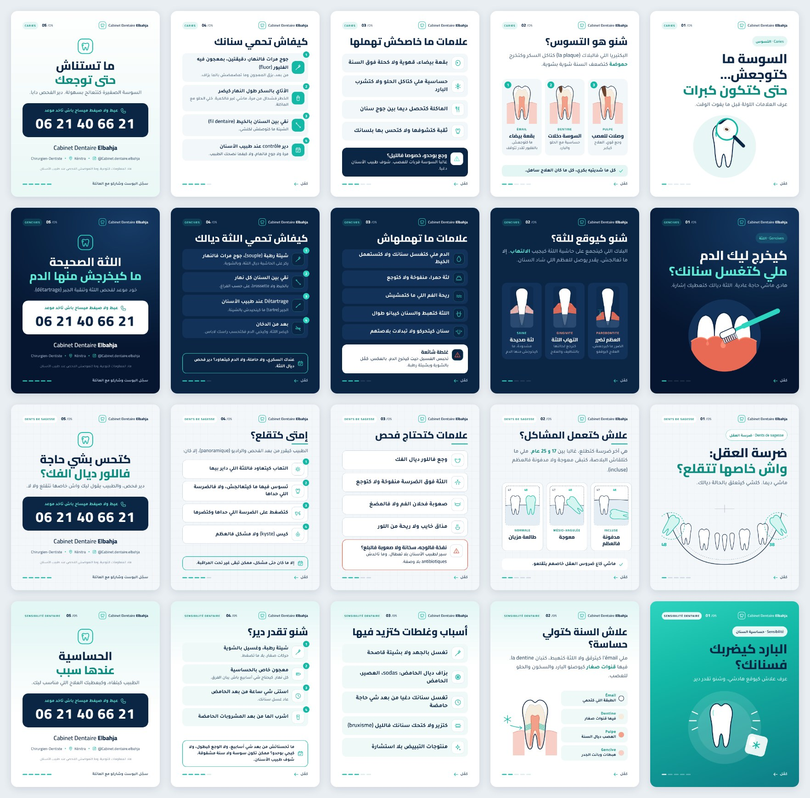

# Instagram carousels · Cabinet Dentaire Elbahja

4 educational carousels × 5 slides, **1080 × 1350 (4:5)**, Moroccan Darija in Arabic script, with simple French dental terms.



| Post | Topic | Visual identity | Files |
| --- | --- | --- | --- |
| 1 | Caries · التسوس | **Clinical White**: white background, turquoise color blocks, tooth cross-sections | [`export/01-caries/`](export/01-caries/) |
| 2 | Gums · اللثة | **Deep Navy**: dark navy background, coral used *only* to show inflammation | [`export/02-gencives/`](export/02-gencives/) |
| 3 | Wisdom teeth · ضرسة العقل | **Blueprint**: light grid paper, technical line drawings, FDI tooth numbers (38 / 48) | [`export/03-dents-de-sagesse/`](export/03-dents-de-sagesse/) |
| 4 | Sensitivity · حساسية السنان | **Thermal**: turquoise "ice" gradient cover, frosty top band on the inside slides | [`export/04-sensibilite/`](export/04-sensibilite/) |

**What every post shares:** the same header (tooth logo + *Cabinet Dentaire Elbahja* + slide counter), the same type system (Cairo ExtraBold for titles, Tajawal for body text), one grid with 84 px margins, rounded 30 px cards, the same footer (progress bar + «كمّل ←») and the same call-to-action slide (phone number in a large block, *Chirurgien-Dentiste · Kénitra · @Cabinet.dentaire.elbahja*, short disclaimer).

**Why these 4 topics:** they are among the most common reasons patients ask a dentist questions, and each one targets a different audience. Caries is for parents and families, with the sugary *atay* habit as the hook. Gums are for adults who think a little bleeding is normal. Wisdom teeth are for young adults aged 17 to 25. Sensitivity is for everyone, and it also gets people to come in for a check-up.

**Recommended order:** 1 → 3 → 2 → 4. Alternate light and dark posts so the grid stays varied. Leave 3 to 4 days between posts.

---

## Edit and re-render

All the text is in [`posts.mjs`](posts.mjs). The layout and the 4 themes are in [`template.mjs`](template.mjs), and the illustrations, drawn by hand as SVG, are in [`art.mjs`](art.mjs).

```bash
npm run carousels          # renders every slide → carousels/export/
npm run carousels -- 02    # only the gums post
```

In the text, `[[mot]]` keeps a French word left-to-right, and `**mot**` puts a word in the accent color. The script fails if any text overflows its slide.

---

## Post 1 · التسوس (Caries)

**Marketing objective:** awareness. Show that a cavity is silent at first, so patients book a check-up (*contrôle*) **before** the pain starts. Target: parents and families. Expected action: save the post, book a check-up.

| # | Slide text (Darija) | Visual description |
| --- | --- | --- |
| 1 | Chip: *Caries · التسوس*<br>**السوسة ما كتوجعش… / حتى كتكون كبرات**<br>عرف العلامات اللولة قبل ما يفوت الوقت. | White background. Very large navy title, last line in turquoise. Below it, a clean line drawing of a molar in a pale turquoise circle. A turquoise magnifying glass sits over a small brown spot on the crown, and the spot appears enlarged inside the lens. |
| 2 | **شنو هو التسوس؟**<br>البكتيريا اللي فالبلاك (la plaque) كتاكل السكر وكتخرج **حموضة** كتضعف السنة شوية بشوية.<br>① *Émail*: بقعة بيضاء. ما كتوجعش. بالفليور تقدر تتوقف<br>② *Dentine*: السوسة دخلات. حساسية مع الحلو والبارد<br>③ *Pulpe*: وصلات للعصب. وجع قوي، العلاج كيكبر<br>✓ كل ما شديتيه بكري، كل ما كان العلاج ساهل. | Three cards side by side, each with the same tooth cross-section (white enamel, ivory dentin, coral pulp, pink gum). The lesion gets deeper from card 1 to card 3. Turquoise numbered badges. A turquoise "note" pill at the bottom. |
| 3 | **علامات ما خاصكش تهملها**<br>• بقعة بيضاء، قهوية ولا كحلة فوق السنة<br>• حساسية ملي كتاكل الحلو ولا كتشرب البارد<br>• الماكلة كتحصل ديما بين جوج سنان<br>• ثقبة كتشوفها ولا كتحس بها بلسانك<br>⚠ **وجع بوحدو، خصوصا فالليل؟** غالبا السوسة قربات للعصب. شوف طبيب الأسنان دغيا. | 4 light-grey rows, each with a turquoise line icon in a white tile (spot, snowflake, fork, tooth). A navy alert card with a turquoise warning icon. |
| 4 | **كيفاش تحمي سنانك**<br>1. جوج مرات فالنهار، دقيقتين، بمعجون فيه الفليور (fluor). *من بعد، بزق المعجون وما تمضمضش بالما بزاف.*<br>2. الأتاي بالسكر طول النهار كيضر. *الخطر فشحال من مرة، ماشي غير فالكمية. خلي الحلو مع الماكلة.*<br>3. نقي بين السنان بالخيط (fil dentaire). *الشيتة ما كتوصلش لكلشي.*<br>4. دير contrôle عند طبيب الأسنان. *مرة ولا جوج فالعام، ولا كيفما نصحك الطبيب.* | 4 numbered cards with solid turquoise icon tiles (toothbrush, tea glass, floss, calendar). The tip in bold and the explanation in grey. |
| 5 | **ما تستناش / حتى توجعك**<br>السوسة الصغيرة كتتعالج بسهولة. دير الفحص دابا.<br>[CTA block] | Common CTA slide (see the end of this document), soft white-to-turquoise gradient. |

**Caption**

> السوسة ما كتعطيش إنذار فالبداية 🦷
> فاللول كتكون غير بقعة بيضاء، وما كتوجعش. ملي كيبدا الوجع، كتكون غالبا وصلات لداخل السنة.
>
> ✅ جوج مرات فالنهار بمعجون فيه الفليور
> ✅ الأتاي بالسكر؟ نقص من عدد المرات، ماشي غير من الكمية
> ✅ contrôle مرة ولا جوج فالعام
>
> 👶 للدراري: معجون بالفليور بقد حبة الروز قبل 3 سنين، وبقد حبة الجلبانة من 3 حتى 6 سنين، ودايما تحت عين الوالدين.
>
> Une carie débutante ne fait pas mal : un contrôle régulier permet de la traiter tôt et simplement.
>
> 📞 06 21 40 66 21 · 📍 Kénitra
> Cabinet Dentaire Elbahja · Chirurgien-Dentiste
>
> ℹ️ هاد المعلومات للتوعية، وما كتعوضش الفحص عند طبيب الأسنان.

**Short CTA:** شي بقعة ولا حساسية؟ ما تستناش الوجع. عيط على 06 21 40 66 21 وخود موعد للـcontrôle.

**Hashtags:** `#التسوس #طبيب_الأسنان #القنيطرة #صحة_الأسنان #نصائح_طبية #Kenitra #DentisteKenitra #CabinetDentaireKenitra #CarieDentaire #SanteBuccoDentaire #DentisteMaroc #Maroc #Darija #CabinetDentaireElbahja`

**Motion concept, "Silent spot":** (1) The molar draws itself as a line drawing, the magnifying glass slides in, and the brown spot "pulses" inside the lens. (2) The 3 cross-sections appear one after another, and the lesion grows deeper in each (mask animation). (3) The icons draw themselves, then the alert card slides up with a soft vibration. (4) The tea glass fills with sugar cubes, a counter "×1, ×2, ×6…" shows that frequency is the problem. (5) The phone number types itself out, digit by digit. Calm music, 15 to 20 s per Reel, or the same animation applied to each slide of the carousel.

---

## Post 2 · اللثة (Gums)

**Marketing objective:** break the myth that "a little blood is normal". Make people want to book a gum check-up and a professional cleaning (*détartrage*). Target: adults aged 25 to 55, smokers, people with diabetes, pregnant women.

| # | Slide text (Darija) | Visual description |
| --- | --- | --- |
| 1 | Chip: *Gencives · اللثة*<br>**كيخرج ليك الدم / ملي كتغسل سنانك؟**<br>هادي ماشي حاجة عادية. اللثة ديالك كتعطيك إشارة. | Navy radial gradient background. White title, second line in light turquoise. In a slightly lighter navy circle, three white front teeth over a coral gum line, a coral drop, and a turquoise toothbrush placed at an angle on the gum line. |
| 2 | **شنو كيوقع للثة؟**<br>البلاك اللي كيتجمع على حاشية اللثة كيجيب **الالتهاب**. إلا ما تعالجش، يقدر يوصل للعظم اللي شاد السنان.<br>*Saine*: لثة صحيحة. مشدودة، ما كيخرجش منها الدم<br>*Gingivite*: التهاب اللثة. كترجع لحالتها بالتنظيف والعلاج<br>*Parodontite*: العظم تضرر. الضرر ما كيرجعش، العلاج كيوقفو | 3 navy cards, each with a cross-section of a tooth in its socket: pale pink gum, then swollen coral gum with red dots, then gum and bone that have pulled back (dotted bone line, turquoise arrow showing the bone loss). The French labels are coloured turquoise, then coral. |
| 3 | **علامات ما تهملهاش**<br>• الدم ملي كتغسل سنانك ولا كتستعمل الخيط<br>• لثة حمرا، منفوخة ولا كتوجع<br>• ريحة الفم اللي ما كتمشيش<br>• اللثة كتهبط والسنان كيبانو طوال<br>• سنان كيتحركو ولا تبدلات بلاصتهم<br>⚠ **غلطة شائعة:** تحبس الغسيل حيت كيخرج الدم. بالعكس: كمّل بالشوية وبشيتة رطبة. | 5 navy rows with turquoise outlined icons. A **white** alert card with a coral warning icon, which stands out against the dark background. |
| 4 | **كيفاش تحمي اللثة ديالك**<br>1. شيتة رطبة (souple)، جوج مرات فالنهار. *ركز على الحاشية ديال اللثة، وبالشوية.*<br>2. نقي بين السنان كل نهار. *بالخيط ولا brossette، على حسب الفراغ.*<br>3. Détartrage عند طبيب الأسنان. *الجير (tartre) ما كيتحيدش بالشيتة.*<br>4. بعد من الدخان. *كيضر اللثة، وكيخبي الدم فكتحسب راسك لاباس.*<br>📅 عندك السكري، ولا حاملة، ولا الدم كيتعاود؟ دير فحص ديال اللثة. | 4 numbered navy cards plus a "consult" box with a turquoise outline. |
| 5 | **اللثة الصحيحة / ما كيخرجش منها الدم**<br>خود موعد لفحص اللثة وتنقية الجير (détartrage).<br>[CTA block] | Common CTA on a navy background. The phone block is **white** with navy text. |

**Caption**

> الدم ملي كتغسل سنانك ماشي "عادي" 🩸
> غالبا هادي أول علامة ديال التهاب اللثة (gingivite). فهاد المرحلة، كترجع لحالتها بالتنظيف والعلاج.
> إلا تهملات، يقدر يوصل الالتهاب للعظم اللي شاد السنان (parodontite).
>
> ❌ ما تحبسش الغسيل حيت كيخرج الدم
> ✅ شيتة رطبة + الخيط + détartrage عند الطبيب
>
> 🚬 الدخان كيخبي الدم، فبزاف ديال المدخنين ما كيعيقوش بالمشكل حتى كيكبر.
> 🤰 الحمل والسكري كيزيدو فخطر التهاب اللثة: الفحص مهم.
>
> Saignement des gencives = signal d'alerte. Un bilan parodontal permet d'agir tôt.
>
> 📞 06 21 40 66 21 · 📍 Kénitra
> Cabinet Dentaire Elbahja · Chirurgien-Dentiste
>
> ℹ️ هاد المعلومات للتوعية، وما كتعوضش الفحص عند طبيب الأسنان.

**Short CTA:** اللثة ديالك كيخرج منها الدم؟ عيط على 06 21 40 66 21 وخود موعد لفحص اللثة.

**Hashtags:** `#اللثة #التهاب_اللثة #طبيب_الأسنان #القنيطرة #صحة_الفم #Kenitra #DentisteKenitra #Gingivite #Parodontite #Detartrage #SanteBuccoDentaire #DentisteMaroc #Maroc #CabinetDentaireElbahja`

**Motion concept, "Signal":** (1) The coral drop falls in slow motion from the gum line, and the title appears word by word. (2) A single cross-section changes state, healthy → gingivitis → periodontitis (the gum turns coral, the bone line goes down, the arrow measures the loss). (3) The signs light up one after another, like warning lights. (4) The toothbrush moves gently along the gum line at 45°, then the tartar disappears. (5) The navy fades to a lighter blue, then the phone number appears.

---

## Post 3 · ضرسة العقل (Wisdom teeth)

**Marketing objective:** reassure young adults (no automatic extraction) and position the practice as the place to assess the case (exam plus X-ray). Target: 17 to 30 year olds, students, and parents of teenagers.

| # | Slide text (Darija) | Visual description |
| --- | --- | --- |
| 1 | Chip: *Dents de sagesse · ضرسة العقل*<br>**ضرسة العقل: / واش خاصها تتقلع؟**<br>ماشي ديما. كلشي كيتعلق بالحالة ديالك. | Light grid paper (blueprint). The lower jaw drawn as a curve, like a panoramic X-ray. The teeth are white line drawings. The two wisdom teeth are filled in light turquoise, tilted, and circled with dashed lines, labelled **48** and **38** (FDI numbering). |
| 2 | **علاش كتعمل المشاكل؟**<br>هي آخر ضرسة كتطلع، غالبا بين **17 و 25 عام**. ملي ما كتلقاش البلاصة، كتبقى معوجة ولا مدفونة فالعظم (incluse).<br>*Normale*: طالعة مزيان · *Mésio-angulée*: معوجة · *Incluse*: مدفونة فالعظم<br>✓ ماشي كاع ضروس العقل خاصهم يتقلعو. | 3 "technical drawing" panels with dashed borders: the 47 and 48 teeth with the bone line. 48 is first upright, then tilted towards 47, then lying flat inside the bone. |
| 3 | **علامات كتحتاج فحص**<br>• وجع فاللور ديال الفك<br>• اللثة فوق الضرسة منفوخة ولا كتوجع<br>• صعوبة فحلان الفم ولا فالمضغ<br>• مذاق خايب ولا ريحة من اللور<br>⚠ **نفخة فالوجه، سخانة ولا صعوبة فالبلع؟** سير لطبيب الأسنان بلا تعطال. وما تاخدش antibiotiques بلا وصفة. | White rows with thin borders over the grid. The alert card has a coral border. A short turquoise rule under the title, in the blueprint style. |
| 4 | **إمتى كتقلع؟**<br>الطبيب كيقرر من بعد الفحص والراديو (panoramique)، إلا كان:<br>1. التهاب كيتعاود فاللثة اللي داير بيها<br>2. تسوس فيها ما كيتعالجش، ولا فالضرسة اللي حداها<br>3. كتضغط على الضرسة اللي حداها وكتضرها<br>4. كيس (kyste) ولا مشكل فالعظم<br>📅 إلا ما كان حتى مشكل، ممكن تبقى غير تحت المراقبة. | 4 numbered cards (icons: infection, tooth, neighbouring tooth, cyst). A turquoise box: "monitoring is also an option". |
| 5 | **كتحس بشي حاجة / فاللور ديال الفك؟**<br>دير فحص، والطبيب يقول ليك واش خاصها تتقلع ولا لا.<br>[CTA block] | Common CTA on the grid paper. |

**Caption**

> ضرسة العقل: نقلعوها ولا لا؟ 🤔
> الجواب ماشي ديما "قلعها". كاين اللي طالعة مزيان وما دايراش حتى مشكل، وكاين اللي معوجة ولا مدفونة وكتسبب التهاب ولا كتضر الضرسة اللي حداها.
>
> 🔎 القرار كيكون من بعد الفحص والراديو.
> ⚠️ نفخة فالوجه، سخانة، ولا صعوبة فالبلع ولا فحلان الفم: سير للطبيب بلا تعطال.
> ❌ ما تاخدش antibiotiques بلا وصفة، وما تحطش الأسبرين على اللثة.
>
> Dents de sagesse : l'extraction n'est pas systématique. Seul un examen clinique et radiologique permet de décider.
>
> 📞 06 21 40 66 21 · 📍 Kénitra
> Cabinet Dentaire Elbahja · Chirurgien-Dentiste
>
> ℹ️ هاد المعلومات للتوعية، وما كتعوضش الفحص عند طبيب الأسنان.

**Short CTA:** وجع فاللور ولا اللثة منفوخة؟ عيط على 06 21 40 66 21 باش تدير فحص لضرسة العقل.

**Hashtags:** `#ضرسة_العقل #ضرس_العقل #طبيب_الأسنان #القنيطرة #Kenitra #DentDeSagesse #DentsDeSagesse #DentisteKenitra #ChirurgieDentaire #DentisteMaroc #SanteBuccoDentaire #Maroc #CabinetDentaireElbahja`

**Motion concept, "Blueprint scan":** (1) A turquoise scan line sweeps the grid paper and reveals the jaw like a panoramic X-ray, then the dashed circles lock onto 38 and 48 with a "target" sound. (2) In the 3 panels, the wisdom tooth rotates from 0° to 42° to 82° and sinks into the bone. (3) Each sign appears with a small radar pulse. (4) A checklist ticks off the 4 reasons, then "monitoring" appears as a calm alternative. (5) The grid zooms out to the CTA. Very good as a 20 s Reel.

---

## Post 4 · حساسية السنان (Sensitivity)

**Marketing objective:** turn a frequent, minimised complaint ("I just have sensitive teeth") into a reason to see the dentist, without encouraging self-diagnosis. Target: everyone, especially people who drink soda or acidic juice, or who use whitening products.

| # | Slide text (Darija) | Visual description |
| --- | --- | --- |
| 1 | Chip: *Sensibilité · حساسية السنان*<br>**البارد كيضربك / فسنانك؟**<br>عرف علاش كيوقع هادشي، وشنو تقدر دير. | Full turquoise to deep teal gradient. White title, second line in navy. A white molar in the centre of soft concentric circles, white "shock" lines on each side, and a white ice cube with a turquoise snowflake, tilted. |
| 2 | **علاش السنة كتولي حساسة؟**<br>ملي l'émail كيترقق ولا اللثة كتهبط، كتبان la dentine. فيها **قنوات صغار** كيوصلو البارد والسخون والحلو للعصب.<br>*Émail*: الطبقة اللي كتحمي · *Dentine*: فيها قنوات صغار · *Pulpe*: العصب ديال السنة · *Gencive*: هبطات وبانت الجدر | A tooth cross-section with the gum pulled back. The turquoise tubules are visible on the exposed root, and a snowflake with an arrow points at the area. On the right, 4 colour-coded labels (colour dot, French term, Darija explanation). A frosty gradient at the top of the slide. |
| 3 | **أسباب وغلطات كتزيد فيها**<br>• تغسل بالجهد ولا بشيتة قاصحة<br>• بزاف ديال الحامض: sodas، العصير، الحامض<br>• تغسل سنانك دغيا من بعد شي حاجة حامضة<br>• كتزير ولا كتحك سنانك فالليل (bruxisme)<br>• منتوجات التبييض بلا استشارة | 5 large rows with icons (toothbrush, lemon, clock, grinding teeth, sparkle). |
| 4 | **شنو تقدر دير؟**<br>1. شيتة رطبة، وغسيل بالشوية. *حركات صغار، بلا ما تضغط.*<br>2. معجون خاص بالحساسية. *كل نهار. كيحتاج شي أسابيع باش يبان الفرق.*<br>3. استنى شي ساعة من بعد الحامض. *عاد غسل سنانك.*<br>4. اشرب الما من بعد المشروبات الحامضة.<br>📅 ما تحسناتش من بعد شي أسابيع، ولا الوجع كيطول، ولا كيجي بوحدو؟ ممكن تكون سوسة ولا سنة مشقوقة. شوف طبيب الأسنان. | 4 numbered cards plus a box with a turquoise outline. |
| 5 | **الحساسية / عندها سبب**<br>الطبيب كيلقاه، وكيعطيك العلاج اللي مناسب ليك.<br>[CTA block] | Common CTA, gradient from frosty turquoise to white. |

**Caption**

> كتحس بشي ضربة ملي كتشرب شي حاجة باردة؟ 🥶
> الحساسية كتوقع ملي كتبان la dentine: l'émail كيترقق، ولا اللثة كتهبط.
>
> ✅ شيتة رطبة وغسيل بالشوية
> ✅ معجون خاص بالحساسية، كل نهار (كيحتاج شي أسابيع)
> ✅ استنى شي ساعة من بعد العصير ولا الحامض عاد غسل سنانك
>
> ⚠️ الحساسية ممكن تخبي سوسة، سنة مشقوقة، ولا مشكل فاللثة. إلا ما تحسناتش، ولا الوجع كيطول، ولا كيجي بوحدو، دير فحص.
>
> Sensibilité dentaire : un dentifrice adapté peut soulager, mais seul un examen permet d'en trouver la cause.
>
> 📞 06 21 40 66 21 · 📍 Kénitra
> Cabinet Dentaire Elbahja · Chirurgien-Dentiste
>
> ℹ️ هاد المعلومات للتوعية، وما كتعوضش الفحص عند طبيب الأسنان.

**Short CTA:** الحساسية ما بغاتش تمشي؟ عيط على 06 21 40 66 21 باش نلقاو السبب.

**Hashtags:** `#حساسية_الأسنان #طبيب_الأسنان #القنيطرة #صحة_الأسنان #Kenitra #SensibiliteDentaire #DentsSensibles #DentisteKenitra #CabinetDentaireKenitra #DentisteMaroc #SanteBuccoDentaire #Maroc #CabinetDentaireElbahja`

**Motion concept, "Cold shock":** (1) An ice cube falls, and frost spreads over the turquoise gradient. The tooth "vibrates" for 3 frames on «كيضربك». (2) The gum pulls back, turquoise impulses travel along the tubules towards the pulp, and the pulp flashes. (3) The causes appear with their icons, and the lemon "drips". (4) A 60-minute clock fills up, then the toothbrush appears. (5) Fade to the CTA. Use a crisp "ice" sound effect at the start only, nothing aggressive.

---

## Common CTA slide (slide 5 of every post)

- Logo: rounded square with a turquoise tooth outline.
- Title in 2 lines, specific to the post (second line in turquoise).
- Phone block, full width: «عيط ولا صيفط ميساج باش تاخد موعد» above **06 21 40 66 21** in large type (Cairo ExtraBold, 104 px, easy to read on a phone).
- **Cabinet Dentaire Elbahja**, then *Chirurgien-Dentiste · 📍 Kénitra · @Cabinet.dentaire.elbahja*.
- Disclaimer: «هاد المعلومات للتوعية، وما كتعوضش الفحص عند طبيب الأسنان.»
- Footer: «سجّل البوست وشاركو مع العائلة» (save and share are the 2 signals Instagram values most).

## Design system

| Token | Value |
| --- | --- |
| Navy | `#0B2545` (titles, dark backgrounds, CTA block) |
| Turquoise | `#14B8A6` (accent) · `#0E8C80` (turquoise text on white, for contrast) · `#2DD4BF` (on navy) |
| White / surfaces | `#FFFFFF` · `#F2F8FA` · `#F3F7FA` (blueprint) |
| Anatomy (only inside illustrations) | enamel `#FFFFFF`, dentin `#F5ECDD`, pulp `#F2A08A`, gum `#F7CFC7`, decay `#6B4430`, inflammation `#E86A55` |
| Titles | Cairo 800, 72 to 94 px |
| Body | Tajawal 500 / 700, 38 to 42 px (never below 25 px) |
| Grid | 1080 × 1350, side margins 84 px, nothing important within 40 px of the edges (Instagram crops the grid preview to 3:4) |

## Production prompts (to rebuild a slide in Canva, Figma or an AI image tool)

Use these as an art-direction base. **Always add the Arabic text in Canva or Figma afterwards**, because image generators make mistakes in Arabic script.

> **Shared base:** *Instagram carousel slide, 1080×1350 portrait, premium dental clinic branding, minimal flat vector illustration with clean navy (#0B2545) line art, turquoise (#14B8A6) accents and white, generous white space, rounded cards, soft shadows, no photos, no gore, no cartoon faces, professional medical agency style, leave the top 45% empty for a headline.*

| Slide | Additional prompt |
| --- | --- |
| P1 · 1 | *white background, single molar line drawing inside a pale turquoise circle, turquoise magnifying glass enlarging a tiny brown spot on the crown* |
| P1 · 2 | *three side-by-side cards, molar cross-sections with white enamel, ivory dentin, coral pulp, cavity getting deeper from card 1 to 3, numbered turquoise badges* |
| P2 · 1 | *dark navy radial gradient, three white front teeth over a muted coral gum line with one small coral drop, turquoise toothbrush touching the gumline at 45 degrees* |
| P2 · 2 | *three dark navy cards with tooth-in-socket cross-sections: healthy pink gum, swollen coral gum, receded gum and lowered dotted bone line with a turquoise measurement arrow* |
| P3 · 1 | *light blueprint grid paper, technical line drawing of a lower jaw like a panoramic x-ray, two tilted wisdom teeth filled light turquoise and circled with dashed lines, labels 38 and 48* |
| P3 · 2 | *three dashed technical-drawing panels showing a wisdom tooth upright, tilted 45° against the neighbour molar, and lying horizontal inside the bone* |
| P4 · 1 | *turquoise to deep teal gradient, white molar at center with concentric soft circles, white shock lines on both sides, white ice cube with turquoise snowflake* |
| P4 · 2 | *tooth cross-section with receded gum, exposed root showing fine turquoise dentinal tubules, small snowflake with an arrow pointing at the exposed neck* |
| Lists / tips | *rounded rows, each with a turquoise outline icon in a white square tile, no text* |
| CTA | *centered tooth logo in a rounded square, large navy rounded rectangle for a phone number, soft white-to-turquoise gradient* |

## Medical review notes

- No invented statistics. The age range for wisdom teeth (17 to 25) is given as "often" (غالبا).
- No promised results: sensitivity toothpaste "needs a few weeks", and the decision to extract is made "after the exam and the X-ray".
- No self-diagnosis: every post sends people to an exam, and red flags (swelling, fever, spontaneous night pain) mean "see the dentist without delay".
- Evidence-based advice: fluoride toothpaste twice a day, *spit, don't rinse*, sugar frequency matters, interdental cleaning, keep brushing gums that bleed, smoking hides gum bleeding, wait before brushing after acidic food or drink.
- The practice must check before posting: whether the panoramic X-ray is taken at the practice or prescribed elsewhere (post 3 does not say), and the full street address if you want to add it to the CTA.
